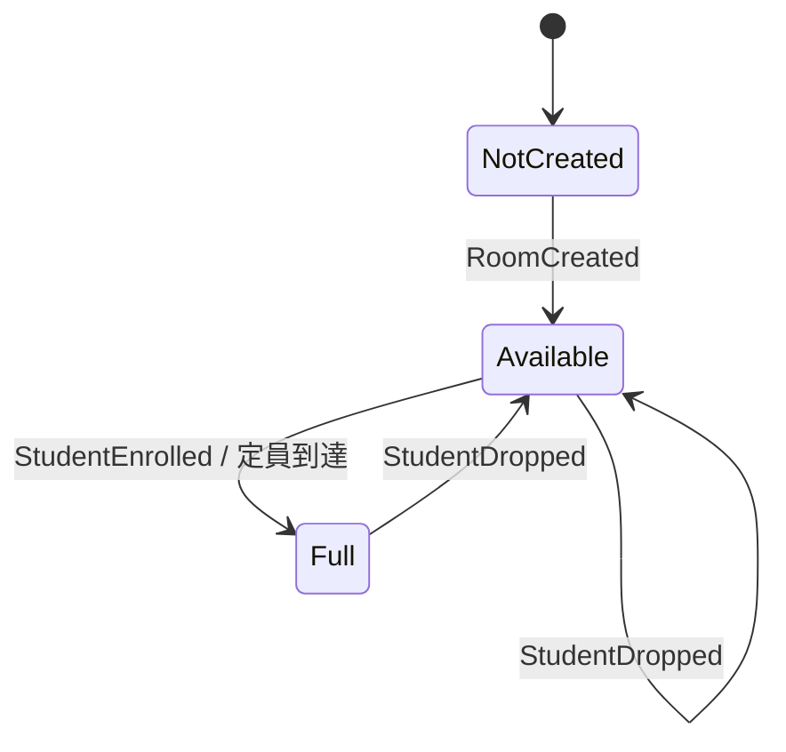

# フェーズを型で表すClassroom Decider

同じ教室への登録・解除を、C#・Rust・TypeScript・Java・Go・Swiftで実装します。まず各言語の **Models → Decider → Main** を読むと、型と処理の対応を追えます。

参照したのは[SekibanのImmutableModels](https://github.com/J-Tech-Japan/Sekiban/tree/main/templates/Sekiban.Dcb.Templates/content/Sekiban.Dcb.Orleans.Decider/SekibanDcbDecider.ImmutableModels)です。とくに[AvailableClassRoomState](https://github.com/J-Tech-Japan/Sekiban/blob/main/templates/Sekiban.Dcb.Templates/content/Sekiban.Dcb.Orleans.Decider/SekibanDcbDecider.ImmutableModels/States/ClassRoom/AvailableClassRoomState.cs)と[イベント別のValidate / Evolve](https://github.com/J-Tech-Japan/Sekiban/blob/main/templates/Sekiban.Dcb.Templates/content/Sekiban.Dcb.Orleans.Decider/SekibanDcbDecider.ImmutableModels/States/ClassRoom/Deciders/StudentEnrolledInClassRoomDecider.cs)を題材にしています。Sekibanそのものを移植したものではなく、1つの教室ストリームに絞った比較用サンプルです。

## 型と処理を読む

| 言語 | State / Command / Event | decide / evolve / replay | 実行・JSON境界 |
|---|---|---|---|
| C# | [Models.cs](csharp/Models.cs) | [Decider.cs](csharp/Decider.cs) | [Program.cs](csharp/Program.cs) |
| Rust | [models.rs](rust/src/models.rs) | [decider.rs](rust/src/decider.rs) | [main.rs](rust/src/main.rs) |
| TypeScript | [models.ts](typescript/models.ts) | [decider.ts](typescript/decider.ts) | [main.ts](typescript/main.ts) / [wire.ts](typescript/wire.ts) |
| Java | [Models.java](java/Models.java) | [Decider.java](java/Decider.java) | [Main.java](java/Main.java) |
| Go | [models.go](go/domain/models.go) | [decider.go](go/domain/decider.go) | [main.go](go/main.go) / [wire.go](go/wire.go) |
| Swift | [models.swift](swift/models.swift) | [decider.swift](swift/decider.swift) | [main.swift](swift/main.swift) / [wire.swift](swift/wire.swift) |

C#はclosed record、Javaはsealed interface＋recordです。Rust・Swiftはenum、TypeScriptは判別共用体、Goはinterface＋structで同じケースを表します。C#のunionからJSON用の基底型に変換する処理は挟みません。

## コード量の比較

分類はファイル単位です。**Model**は上の表の型定義ファイル、**Decider**はdecide / evolve / replayのファイル、**その他**は各言語のMain・JSON境界ファイルです。Model内のJSON属性や補助メソッドもModelに含めます。

- 行数：空行・コメント・括弧だけの行を含む物理行数。最終行に改行がなくても1行と数えます。
- 空白以外の文字数：Unicodeの空白文字（スペース・タブ・改行など）をすべて除いた文字数。UTF-8のバイト数ではありません。コメント・括弧・属性は含め、文字列リテラルやコメント中の空白も除きます。
- 対象：各言語の手書きソースだけ。設定・プロジェクトファイル、依存ロック、fixtures、README、共通Python実行器、集計スクリプト、CI、生成物は除外します。
- 合計：Model＋Decider＋その他。同じソースを一度だけ数えます。

<!-- code-stats:start -->

### 行数（空行を含む）

| 言語 | Model | Decider | その他 | 合計 |
|---|---:|---:|---:|---:|
| C# | 28 | 78 | 68 | 174 |
| Rust | 41 | 113 | 74 | 228 |
| TypeScript | 19 | 72 | 79 | 170 |
| Java | 46 | 74 | 43 | 163 |
| Go | 57 | 105 | 180 | 342 |
| Swift | 53 | 43 | 118 | 214 |

### 空白以外の文字数

| 言語 | Model | Decider | その他 | 合計 |
|---|---:|---:|---:|---:|
| C# | 990 | 2,397 | 2,233 | 5,620 |
| Rust | 864 | 2,447 | 1,355 | 4,666 |
| TypeScript | 731 | 2,670 | 2,767 | 6,168 |
| Java | 1,763 | 2,376 | 1,514 | 5,653 |
| Go | 1,206 | 2,056 | 3,901 | 7,163 |
| Swift | 1,024 | 1,855 | 3,595 | 6,474 |

<!-- code-stats:end -->

[集計スクリプト](code_stats.py)で再計算できます。各ファイルの内訳はJSONでも出力できます。CIはREADMEの値が最新であることを確認します。

```bash
python3 samples/decider/code_stats.py --write
python3 samples/decider/code_stats.py --check
python3 samples/decider/code_stats.py --json
```

## Stateのフェーズが切り替わる



| Stateの型 | 持つデータ | 意味 |
|---|---|---|
| NotCreated | なし | 教室がまだない |
| Available | Roster（名前・定員・登録者） | 登録者数が定員未満 |
| Full | Roster（名前・定員・登録者） | 定員に到達 |

同じデータを保持するAvailable / Fullも、違う型・enumケースです。最後の1人を登録したイベントでFullに変わり、Fullから1人解除したイベントでAvailableに戻ります。教室がない状態を、名前や定員のダミー値で表しません。

イベントも別の型です。`RoomCreated(name, capacity)`、`StudentEnrolled(studentId)`、`StudentDropped(studentId)`を使い、イベント種別ごとに保持するデータが変わります。

## Deciderの境界

```text
decide(state, command) -> accepted events / business rejection
evolve(state, event)   -> new state / invalid history
replay(events)         -> fold(evolve, NotCreated, events)
```

- `decide`は登録可否などを判断し、イベントまたは拒否コードを返します。Stateを書き換えません。
- 呼び出し側が、成功したイベントだけを履歴に追加して`evolve`へ渡します。
- `evolve`はイベントを適用して新しいStateを返します。DB、現在時刻、乱数、外部問い合わせは使いません。
- `replay`は保存済みイベントから復元します。過去のコマンドを再判断する処理ではありません。
- 拒否されたコマンドでは、Stateとイベント履歴が変わりません。型の違う無関係イベントを無条件に無視する実装でもありません。

この例の`evolve`は正規の順序の履歴を要求します。作成前の登録、重複登録、定員超過、未登録者の解除は不正履歴として失敗します。イベントの重複配信を自動で冪等化する仕組みではありません。

## 共通ルール

| 操作 | 条件・結果 |
|---|---|
| Create | 未作成の場合だけ成功。名前は空文字不可、定員は1〜10 |
| Enroll | 作成済み、空でないID、未登録、空席ありの場合だけ成功 |
| Drop | 作成済み、空でないID、登録済みの場合だけ成功 |
| 重複登録 | `already_enrolled`。満員の場合でも重複の判定を先に行う |
| 満員への新規登録 | `full` |
| 作成前の登録・解除 | `not_created` |
| 拒否の返し方 | 各言語のResult／判別共用体／errorを使い、CLIでは同じコードに揃える |

`lifecycle`では、作成前の拒否 → 作成 → 2人登録してFull → 満員で拒否 → 解除してAvailable → 再登録してFull、までを通します。[入力](fixtures/lifecycle.json)と[独立した期待値](fixtures/expected.json)をそのまま確認できます。`resume`は、保存済み履歴からFullを復元して続きのコマンドを処理する例です。

## 実行

リポジトリのルートから実行します。Python 3、対象言語のツールチェーンが必要です。

```bash
# 1言語だけ。JSONで初期状態・最終状態・発生イベント・各判断を表示
python3 samples/decider/run.py --language csharp
python3 samples/decider/run.py --language rust --scenario resume
python3 samples/decider/run.py --language typescript
python3 samples/decider/run.py --language java
python3 samples/decider/run.py --language go
python3 samples/decider/run.py --language swift

# 6言語の共通シナリオ・JSON往復・言語間のイベント履歴を確認
python3 samples/decider/run.py --verify

# C#をNative AOTで発行して同じ検証
python3 samples/decider/run.py --language csharp --native-aot --verify

# Nodeでの実行と型チェックは別
npm ci --prefix samples/file-based
samples/file-based/node_modules/.bin/tsc -p samples/decider/typescript/tsconfig.json
```

C#はリポジトリ固定の.NET 11 GA、Nodeは24、Javaは21、Goは1.23以降、Rustはedition 2024対応のstable、SwiftはFoundationを使います。実行器はビルドと既存のJackson / Serde依存を用意します。Rustの依存はCargo.lockに固定しています。生成物はこのフォルダの`.build/`に置きます。

Pythonを介さずCLIを呼ぶこともできます。入力は全言語共通のJSONです。

```bash
dotnet run --project samples/decider/csharp/Decider.csproj < samples/decider/fixtures/lifecycle.json
node samples/decider/typescript/main.ts < samples/decider/fixtures/lifecycle.json
(cd samples/decider/go && go run .) < samples/decider/fixtures/lifecycle.json
```

出力の`steps`でフェーズと拒否を追えます。`initial`は最初のState、`state`は最後のState、`restored`はスナップショットのJSON往復、`replayed`は型付きイベントをJSONから読み戻して再生したStateです。

## JSONと型判別

State / Command / Eventで`$type`を揃えます。たとえば満員のStateは次の形です。

```json
{"$type":"Full","roster":{"name":"Lab","capacity":2,"students":["alice","bob"]}}
```

- C#：標準STJのclosed型推論とJsonSerializerContext。独自コンバーターなし、JSONリフレクション無効。Native AOTでも同じコードです。
- Rust：Serdeのinternally tagged enum。
- Java：JacksonのJsonTypeInfo / JsonSubTypes。
- TypeScript：型定義とは別に、wire.tsでJSON入力を構造検査。
- Swift：通常のCodable合成形式とは違うため、wire.swiftで共通の`$type`形式へ対応。
- Go：wire.goでタグを読んで具象structへ復元。

JSONのプロパティ順は揃えていません。metadata-orderシナリオでは、入力の$typeを最後に置いて回帰検証しています。C#では`AllowOutOfOrderMetadataProperties = true`を指定し、別言語が`$type`を後ろに書いても読めるようにしています。

タグは比較のため型・ケース名に揃えています。C#で長期保存用のタグを改名から独立させたい場合は、推論の代わりにJsonDerivedTypeの明示登録を使えます。

## 何を検証しているか

[run.py](run.py)が6つの固定シナリオ、各シナリオのイベント履歴からの復元、7つの不正な履歴・タグを確認します。さらに、各言語の出力イベントを別言語へ渡し、解除コマンドを続けて実行する36組の検査を行います。`initial`も期待値と照合し、後の更新で過去のStateが変わっていないことを確認します。比較は各言語の参照等価性ではなく、JSONの論理構造で行います。

[CI](../../.github/workflows/decider-samples.yml)でも6言語・TypeScriptの型チェック・C# Native AOTを実行します。これはコードと振る舞いの比較で、性能測定ではありません。

## 型で守る範囲と、ここでは扱わないこと

C#のclosed、Javaのsealed、Rust・Swiftのenum、TypeScriptのnever検査は、同じソースを再コンパイルした際のケース分岐を検査できます。Goの標準type switchには網羅性検査がないためdefaultが必要です。

ケースの集合を型で限定できることと、定員や重複などの業務上の不変条件は別です。この例はNotCreatedからDeciderが作る状態と、検証された履歴の再生を対象にしています。任意に組み立てたStateや外部スナップショット全般の業務検証APIは用意していません。不正JSONの細かいエラー形式を全言語で揃えることも対象外です。

元のSekibanにある複数タグ・Studentとの整合性・楽観的同時実行制御・Orleans・永続イベントストアは省略しています。実際の永続化では、コマンドが読んだストリーム版とイベント追記を整合させる処理がDeciderの外側に必要です。
