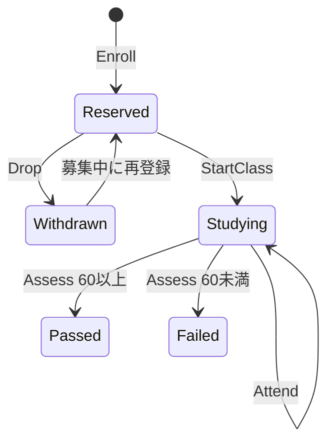

# 履修条件と成績を型で表すDecider Level 2

[Level 1の教室登録](../decider/README.md)に、学年・前提科目・授業開始・出席・成績確定を加えた7言語比較です。C#、F#、Rust、TypeScript＋Zod、Java、Go、Swiftで同じコマンドとイベントを扱います。元の小さな例は変更せず残しています。

## コードを読む

| 言語 | Model | Decider | 実行・JSON境界 | この実装のPros / Cons |
|---|---|---|---|---|
| C# | [Models.cs](csharp/Models.cs) | [Decider.cs](csharp/Decider.cs) | [Program.cs](csharp/Program.cs) | [比較](csharp/README.md) |
| F# | [Models.fs](fsharp/Models.fs) | [Decider.fs](fsharp/Decider.fs) | [Program.fs](fsharp/Program.fs) | [比較](fsharp/README.md) |
| Rust | [models.rs](rust/src/models.rs) | [decider.rs](rust/src/decider.rs) | [main.rs](rust/src/main.rs) | [比較](rust/README.md) |
| TypeScript＋Zod | [models.ts](typescript/models.ts) | [decider.ts](typescript/decider.ts) | [main.ts](typescript/main.ts) / [wire.ts](typescript/wire.ts) | [比較](typescript/README.md) |
| Java | [Models.java](java/Models.java) | [Decider.java](java/Decider.java) | [Main.java](java/Main.java) | [比較](java/README.md) |
| Go | [models.go](go/domain/models.go) | [decider.go](go/domain/decider.go) | [main.go](go/main.go) / [wire.go](go/wire.go) / [domain/json.go](go/domain/json.go) | [比較](go/README.md) |
| Swift | [models.swift](swift/models.swift) | [decider.swift](swift/decider.swift) | [main.swift](swift/main.swift) / [wire.swift](swift/wire.swift) | [比較](swift/README.md) |

## 同じドメイン、同じルール

1つの学校の状態に、生徒一覧・開講クラス一覧・生徒ごとの履修を持ちます。ここでのStateは1つの整合性境界です。生徒IDと開講クラスIDを取り違えないようフィールドを分け、科目と学年には名前のある型と既知のケースを定義しています。ただしIDはまだ文字列で、型の異なるIDラッパーまでは導入していません。

| 概念 | ルール |
|---|---|
| 学年 | Year1 / Year2 / Year3。進級はちょうど1学年ずつ |
| 科目A | Foundation。Year2以上、前提科目なし。合格で1単位 |
| 科目B | Advanced。Year3以上、Foundationの合格実績が必要。合格で2単位 |
| 開講 | 科目と開講クラスは別。f1とf2はどちらもFoundationにできる |
| 定員 | 1〜10。重複登録は満員より先に拒否。取消で席が空く |
| 登録・取消 | 募集中だけ可能。開始後はRegistrationClosed |
| 採点 | 授業中で、出席1回以上、未採点の場合のみ。0〜100点、60点以上で合格 |
| 終了 | 全受講者の採点後だけ可能。取消した生徒は採点対象から外れる |
| 再履修 | 別の開講クラスで再履修できる。同じ募集クラスの取消後の再登録も可能 |
| 前提科目 | 過去の履修にPassedが存在すること。予約・出席・不合格は合格実績にしない |

登録の判定順も揃えています。クラス存在 → 生徒存在 → 募集中 → 重複 → 学年 → 前提科目 → 定員、です。拒否もAccepted／Rejectedのケースと列挙したRejectionで表します。

コマンドはRegisterStudent、PromoteStudent、OpenClass、Enroll、Drop、StartClass、Attend、Assess、CompleteClassです。各操作に対応したイベントを保存し、replayで復元します。

## 状態ごとにデータを変える

| 履修の状態 | その状態で持つデータ |
|---|---|
| Reserved | 追加データなし。登録済みで授業開始前 |
| Studying | attendance（出席数） |
| Passed | score（点数）とcredits（取得単位） |
| Failed | scoreとBelowPassMarkという理由 |
| Withdrawn | StudentRequestという理由 |

Studyingに未確定の点数フィールドを持たせたり、Passedに不合格理由のnullを置いたりしません。実装には各言語のclosed / sealed / enum / 判別共用体 / interfaceを使います。



開講クラスもAvailable／Fullだけではありません。Teachingは開始日のラベルを保持し、Completedは名簿の代わりに生徒ごとの結果一覧を持ちます。過去の開始日や出席の詳細はイベント履歴に残ります。

## nullの代わりに何を使うか

| 表したいこと | このサンプルの表現 |
|---|---|
| 前提科目がない | NoPrerequisite。PassedCourseのcourseをnullにしない |
| まだ採点していない | Reserved / Studying。score: nullを持たない |
| 不合格・取消 | Failed / Withdrawn。理由を別の有限型で表す |
| 生徒・クラスが見つからない | 検索結果のOptionやguard、または存在確認後にUnknownStudent / UnknownClassへ変換 |
| まだ登録していない | 生徒×クラスの履修レコードが存在しない。全組合せにダミーレコードを作らない |
| イベントがない | 空の履歴配列・リスト |
| 処理の拒否 | Rejected(code)。成功時のerror: nullを作らない |

JSON入力にもcommandsとhistoryを必須とし、履歴がないときは[]を渡します。全出力にnullが含まれないことも共通テストで確認します。Swiftの検索で使うOptionalやF#・RustのOptionは、欠損を分岐して処理する道具であり、業務データの未確定フィールドにはしていません。

これは「どんな作り方でも不正なStateを構築できない」という保証ではありません。C#やJavaの参照、Goのinterfaceは言語上null／nilを持てます。公開されたモデルには、不整合なFullやStudyingを直接作れる余地もあります。ClassResultもProgress型なので型だけではPassed／Failedに限定されません。ここでは空のStateから検証したイベントを適用する経路で整合性を守ります。さらに厳密にするなら、結果専用の型、ID・点数のsmart constructor、非公開コンストラクターなどが次の比較対象になります。

## Deciderと整合性の境界

```text
decide(state, command) -> Accepted(events) / Rejected(code)
evolve(state, event)   -> new state / InvalidHistory
replay(events)         -> fold(evolve, empty, events)
```

判断時にDBや現在時刻を読みません。進級、合格実績、席、登録、成績はすべて渡されたStateから判断します。開始日のstartedOnは入力された非空文字列として保持します。暦日としての妥当性や日付の前後関係、時間割の重複は扱っていません。

履歴の再生でもイベントを対応するコマンドの形に戻して同じルールで検査し、その後に状態を適用します。この設計で登録判断と履歴検査の条件のずれを減らしました。一方、過去のイベントにも現在の固定ルールを再適用します。制度変更がある本番運用では、開講時の方針の保存やイベント・ルールのバージョニングが必要です。

元のSekibanのような、別ストリームにある学籍・履修・クラスをまたぐDCBや楽観的同時実行制御は実装していません。学校全体を1つの状態に入れているから、このサンプル内では前提科目確認と座席確保を一緒に判断できます。Stateの同じ版を読んだ複数コマンドの競合は、外側のイベントストアが制御する必要があります。

同一科目の複数クラスへの同時登録や、すでに合格済みの科目への再登録は禁じていません。生徒の休学・退学、単位上限、コマンドの冪等キーも対象外です。

## 実行・検証

リポジトリのルートから実行します。ツールチェーンはLevel 1と同じです。.NETはglobal.json固定の11.0.100、Javaは21です。実行器はZod・Serde・Jacksonなどを用意します。

```bash
python3 samples/decider_level2/run.py --language csharp
python3 samples/decider_level2/run.py --language fsharp
python3 samples/decider_level2/run.py --language typescript --scenario mixed-results
python3 samples/decider_level2/run.py --verify
python3 samples/decider_level2/run.py --language csharp --native-aot --verify
python3 samples/decider_level2/tests/check_exhaustiveness.py

npm ci --prefix samples/file-based
npm ci --prefix samples/decider_level2/typescript
samples/file-based/node_modules/.bin/tsc -p samples/decider_level2/typescript/tsconfig.json
```

F#は.NET 11のReleaseビルドで、TieredCompilationとTieredPGOを有効にします。このCLIの機能検証では十分なウォームアップや速度測定を行わないため、最適化後の速度を比較するものではありません。F#のWASM・Native AOTは今回の対象外です。

[固定した期待値](fixtures/expected.json)と照合する9シナリオがあります。lifecycleでは「学年不足で拒否→進級→A登録→満員→取消→別生徒がA不合格→B拒否→A再履修で60点合格→B登録・100点合格」を追います。mixed-resultsは同じクラスの生徒2人が合格／不合格に分かれるケースです。

各シナリオで初期Stateの保持、全判断と発生イベント、最終State、JSONスナップショット復元、イベント再生、履修状態の網羅的な表示を確認します。さらに、未知タグ・学年、不正履歴・nullなど11入力を拒否し、全7言語の49組で、実際に出力したイベント履歴を交換して履修を継続します。比較するのはJSONの意味で、プロパティ順ではありません。

[ケース追加テスト](tests/check_exhaustiveness.py)は元のソースを変更せず、一時コピーのProgressにPendingReviewを加えてコンパイルします。C#・F#・Rust・TypeScript・Java・Swiftで表示分岐の未対応を検出し、Goでは新しい型がコンパイルでき、実行時defaultに達することを確認します。

[CI](../../.github/workflows/decider-level2-samples.yml)でも全言語・型チェック・ケース追加実験・C# Native AOTを順に実行します。

C#は閉じた階層の標準推論＋ルートだけのSource Generationで、JSONリフレクションを無効にしたNative AOTも検証します。F#は.NET 11標準DU対応を使いますが、[公式仕様](https://learn.microsoft.com/dotnet/core/whats-new/dotnet-11/libraries#systemtextjson-improvements)上この対応はリフレクション方式です。フィールドなしのDUは文字列として出力されるため、期待値の比較時だけprogress／prerequisiteのその表現を正規化します。イベントJSONは正規化せずそのまま交換します。F#の標準DUデシリアライザーによるnull受理も実際に確認したため、入力境界でnullを拒否しています。

## コード量の比較

分類はLevel 1と同じくファイル単位です。Modelは型定義、Deciderは判断・適用・再生・履修表示、その他はMainとJSON境界です。Goのdomain/json.goもその他です。ModelのJSON属性やZodスキーマはModelに含めます。

- 行数は空行・コメント・括弧だけの行を含む物理行数です。
- 文字数はUnicodeの空白を除いた文字数で、バイト数ではありません。文字列やコメントの空白も除きます。
- 設定、依存ロック、生成物、fixtures、テスト、README、共通Python実行器・集計・CIは除外します。
- 長い1行や自動整形の違いがあるため、行数だけで簡潔さを判断しません。JSON共通化の負担も含むので、ドメイン部分のModel＋Deciderとその他を分けて読んでください。

<!-- code-stats:start -->

### 行数（空行を含む）

| 言語 | Model | Decider | その他 | 合計 |
|---|---:|---:|---:|---:|
| C# | 74 | 181 | 34 | 289 |
| F# | 99 | 140 | 38 | 277 |
| Rust | 118 | 173 | 29 | 320 |
| TypeScript＋Zod | 84 | 150 | 23 | 257 |
| Java | 277 | 159 | 28 | 464 |
| Go | 296 | 401 | 693 | 1,390 |
| Swift | 76 | 157 | 307 | 540 |

### 空白以外の文字数

| 言語 | Model | Decider | その他 | 合計 |
|---|---:|---:|---:|---:|
| C# | 3,827 | 7,800 | 1,821 | 13,448 |
| F# | 4,358 | 7,546 | 1,826 | 13,730 |
| Rust | 3,656 | 9,507 | 1,268 | 14,431 |
| TypeScript＋Zod | 5,100 | 7,854 | 1,148 | 14,102 |
| Java | 8,378 | 8,860 | 1,520 | 18,758 |
| Go | 5,203 | 7,760 | 15,111 | 28,074 |
| Swift | 2,874 | 8,754 | 11,573 | 23,201 |

<!-- code-stats:end -->

```bash
python3 samples/decider_level2/code_stats.py --write
python3 samples/decider_level2/code_stats.py --check
python3 samples/decider_level2/code_stats.py --json
python3 samples/decider_level2/check_readmes.py
```

各言語のREADMEには、この複雑さで助かった記法と、実際に増えた負担をソース引用付きで記載しています。引用と行番号の一致もCIで確認します。性能の順位を示すサンプルではありません。
