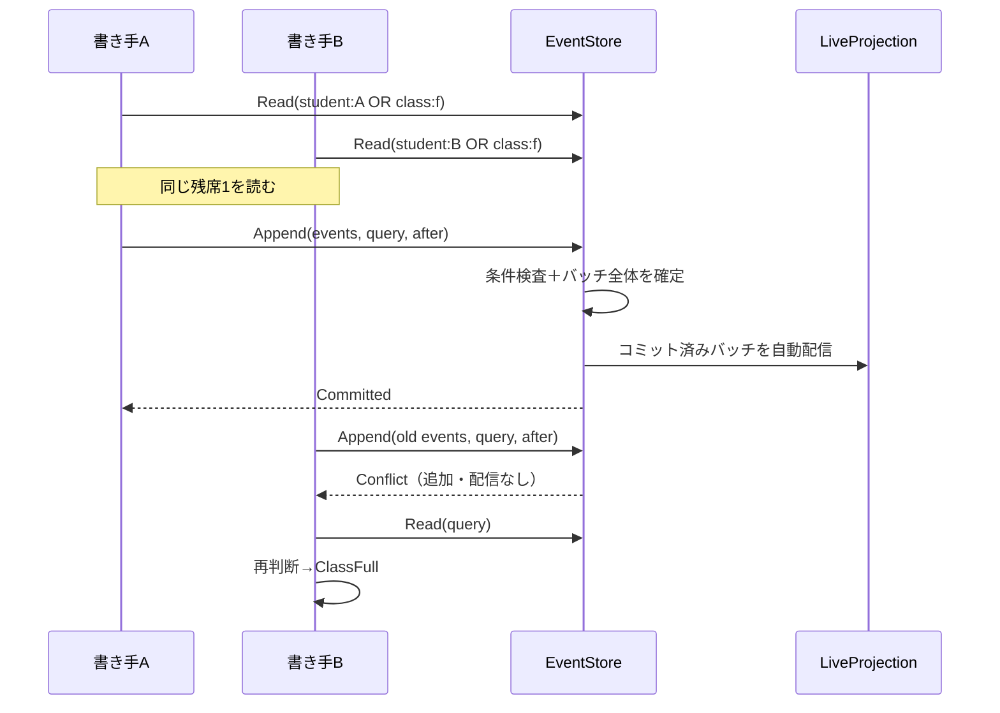

# Decider Level 3：7言語のインメモリES／DCB

[Level 2](../decider_level2/README.md)の履修ドメインを、タグで読む学籍・クラス・履修の判断モデルと、全イベントを受けるライブ一覧投影に分けました。C#、F#、Rust、TypeScript＋Zod、Java、Go、Swiftで、同じ機能とJSON契約を実装します。言語ごとの実コード、行数、空白以外の文字数を比較するためのサンプルです。

## 共通部品とドメインを分ける

| 言語 | 抽出できるライブラリ | 学校の型／判断 | 学校のタグ規則／コマンド接続 | 学校の投影 | 比較 |
|---|---|---|---|---|---|
| C# | [Dcb.cs](csharp/Dcb.cs) | [Models](csharp/Models.cs) / [Decider](csharp/Decider.cs) | [Routing](csharp/Routing.cs) / [Application](csharp/Application.cs) | [Projection](csharp/Projection.cs) | [README](csharp/README.md) |
| F# | [Dcb.fs](fsharp/Dcb.fs) | [Models](fsharp/Models.fs) / [Decider](fsharp/Decider.fs) | [Routing](fsharp/Routing.fs) / [Application](fsharp/Application.fs) | [Projection](fsharp/Projection.fs) | [README](fsharp/README.md) |
| Rust | [dcb.rs](rust/src/dcb.rs) | [models](rust/src/models.rs) / [decider](rust/src/decider.rs) | [routing](rust/src/routing.rs) / [application](rust/src/application.rs) | [projection](rust/src/projection.rs) | [README](rust/README.md) |
| TypeScript＋Zod | [dcb.ts](typescript/dcb.ts) | [models](typescript/models.ts) / [decider](typescript/decider.ts) | [routing](typescript/routing.ts) / [application](typescript/application.ts) | [projection](typescript/projection.ts) | [README](typescript/README.md) |
| Java | [Dcb.java](java/playground/dcb/Dcb.java) | [Models](java/Models.java) / [Decider](java/Decider.java) | [Routing](java/Routing.java) / [Application](java/Application.java) | [Projection](java/Projection.java) | [README](java/README.md) |
| Go | [dcb/store.go](go/dcb/store.go) | [models](go/domain/models.go) / [decider](go/domain/decider.go) | [routing](go/domain/routing.go) / [application](go/application.go) | [projection](go/domain/projection.go) | [README](go/README.md) |
| Swift | [dcb.swift](swift/dcb.swift) | [models](swift/models.swift) / [decider](swift/decider.swift) | [routing](swift/routing.swift) / [application](swift/application.swift) | [projection](swift/projection.swift) | [README](swift/README.md) |

共通部品はSchoolDomain、科目、学年、履修状態を参照しません。イベントをobject／Any／IEventPayloadへ変換せず、EventStore<E>とRecorded<E>にドメインの閉じたイベント型を渡します。コマンドCと拒否Rも型パラメーターです。ドメインのswitch／matchでは元のケースを列挙できます。

コマンド実行ループは具象メモリストアではなく、読み取りと条件付き追記を定義するinterface／trait／protocolに依存します。学校側が渡すのは、コマンドのQuery、イベントのEventDescriptor、判断関数、更新関数、コピー関数です。

[独立ビルドテスト](tests/library_isolation.py)では学校のModels・Deciderを一切含めず、カウンター用のイベント・コマンドでライブラリをコンパイルして実行します。Javaは別パッケージ、Swiftは実際の別モジュールから利用します。Goはdcbパッケージだけを-race付きでテストします。

複数のドメインのイベントを同じ型付きログへ載せる場合は、ホストアプリがそれらをまとめる閉じたイベント集合とメタ情報の関数を定義します。その集合の更新はホストの責任で、ライブラリへ学校や請求などのケースを追加する必要はありません。任意のプラグインによる無制限な拡張と、固定ケースの網羅性を同時に保証する仕組みではありません。

## 学籍・クラス・履修の分離

1つの学校全体のStateをコマンド処理のたびに復元する方式をやめ、別々の更新関数で3つのレジストリを作ります。

| レジストリ | キー | 担当する情報 |
|---|---|---|
| StudentRegister | studentId | 学年・進級 |
| ClassRegister | classId | 科目、定員、名簿、募集／授業中／終了 |
| EnrollmentRegister | (classId, studentId) | 予約、出席、合否、取消、取得単位 |

インメモリの検索は線形走査で、タグ索引はまだ実装していません。判断側へ返すイベントだけをタグで絞ります。

ログ自体は1本です。集約ごとの独立した永続ストリームへ分割するのではなく、DCBのタグで必要な事実を選びます。CommandProcessorはその読み取り結果だけから一時的なDecisionModelを作ります。ライブ一覧の全校データはコマンドの判断元にしません。

例えばbobのBへの登録では、student:bobの学年・過去の履修と、class:b1の状態をORクエリで読みます。別の生徒の学籍や、無関係なクラスの開講イベントまで読む必要はありません。タグで読む履修には科目が必要なので、StudentEnrolledへcourseを持たせています。

授業開始ではClassStartedと受講者ごとのStudyStartedを同じバッチに入れます。これによりクラスの授業開始と、各生徒の履修開始を別々のタグ履歴から復元できます。ClassCompletedには結果一覧を持たせ、クラスの終了状態の復元で別の学籍モデルを参照しません。

Level 2の業務ルールは維持しています。FoundationはYear2以上、AdvancedはYear3以上かつFoundation合格済み。定員は1〜10、採点には出席が必要で60点以上が合格、開始後の登録・取消は拒否します。履修フェーズはReserved／Studying／Passed／Failed／Withdrawnで、未確定値をnullで埋めません。

## タグ・型・コマンドのメタ情報

タグは表示用の文字列を連結せず、構造を持ちます。

```json
{"category":"enrollment","keys":["class-id","student-id"]}
```

タグ文字列はUnicodeスカラーの並びとして一致を判定します。学校ドメインのIDは、呼び出し元が同じ正規化形（NFC）で与える契約です。ドメイン側のSwiftのString辞書には正規等価性があるため、正規化形を混在させる入力は比較対象にしません。

一覧のキー順はUTF-8のバイト順に揃えています。カルチャ依存の比較やUTF-16順との違いは、大文字小文字と補助文字を含む回帰シナリオで確認します。

keysの順序は意味を持ちます。classId="c"とstudentId="a:b"、classId="c:a"とstudentId="b"は別のキーです。内部の履修キーにもtuple／struct／JSONタプル表現を使います。

| イベント | 自動付与するタグ |
|---|---|
| StudentRegistered／StudentPromoted | student(studentId) |
| ClassOpened／ClassStarted／ClassCompleted | class(classId) |
| StudentEnrolled／StudentDropped／StudyStarted／AttendanceRecorded／ResultRecorded | student、class、enrollment(classId, studentId) |

呼び出し側はタグや位置を手入力して追記しません。ストアに渡したドメインのdescribe関数がイベント型名とタグを返し、ストアが位置とcommandIdを付けます。読み込むログのメタ情報も同じ関数で検査します。enrollmentタグは個別履修の検索・診断に使えるメタ情報で、今回の業務コマンドの整合性条件はstudent／classタグを使います。

```text
Recorded<E>
  position  : ストアが採番する1からの連番
  commandId : コマンドから引き継ぐ識別子
  eventType : ドメインのdescribe関数が決める論理イベント型
  tags      : ドメインのdescribe関数が作る構造化タグ
  payload   : 元のドメインのイベント型E
```

commandIdは追跡用で、永続的な冪等キーではありません。同じIDのコマンドをもう一度送ることを、ストア全体で自動的に抑止する実装ではありません。

## 条件付き追記と再判断

[DCB公式仕様](https://dcb.events/specification/)のQueryとAppend Conditionの考え方を、小さな同期APIで実装しています。

- QueryItem内のtagsはAND、typesは指定された型のOR。typesが空なら型を限定しません。
- QueryItem同士はOR。itemsが空のQueryは全件です。
- Readは一致したイベントと、同じロックで取得したログ全体のafterを返します。afterは最後に一致したイベントの位置ではありません。
- Appendはafterより後に条件Queryへ一致するイベントがないかを検査し、なければバッチ全体を同じロックで追加します。
- 競合したバッチは追加も配信もしません。再読み取り・モデル更新・再判断を行い、再び拒否または新しいバッチを作ります。競合は最大3回で打ち切ります。

| コマンド | 読み取り・追記条件の範囲 |
|---|---|
| RegisterStudent／PromoteStudent | studentタグ |
| OpenClass／StartClass／CompleteClass | classタグ |
| Enroll | studentタグ OR classタグ |
| Drop／Attend／Assess | classタグ |



Prepare／Commit操作は、この競合をsleepなしで再現するテスト用スケジューラーです。業務コマンドそのものはRegisterStudent、Enrollなどの閉じたCommand型です。通常はExecuteが読み取りから再試行まで行います。準備時のRejectedは読み取り時点の判断として返し、書き込みを伴わない拒否に条件付き追記は行いません。

## 一覧はライブプロジェクションから返す

LiveProjection<E,S>も共通部品です。ドメインのreduceとcopyStateを受け取り、チェックポイントと状態を管理します。学校側は3つのレジストリを更新し、それらをSchoolListへ変換します。

- 起動時は全イベントを再生してから購読を登録します。再生と登録は追記と同じロックで行い、間にイベントが抜ける窓を作りません。
- 追記が成功したら、ストアがコミット済みバッチを自動配信します。アプリがその都度投影更新を呼ぶ方式ではありません。
- バッチを投影へ反映する場合も、更新後の状態と位置を一緒に公開します。
- 同じ位置の再配信は無視し、位置の欠落は拒否します。途中まで適用してチェックポイントだけ残すことはしません。
- ListAllは投影のスナップショットを返します。初期に取得した一覧が後続の更新で書き換わらないことも確認します。
- 全ログから別の投影を再構築し、ライブ投影と一致することを確認します。CLIのRebuildは照合用の再構築で、購読の自動復旧コマンドではありません。

購読関数が失敗を返した場合は切り離し、listenerFaultsへ記録します。C#・F#・Java・TypeScriptは例外、Goはpanic、Rustはunwindするpanicも通知失敗として分離します。追記済みの事実を追記失敗へ戻さず、他の購読者への配信を続けます。Swiftの購読関数は非throwingでfalseを返す契約です。Swiftのfatal errorやabort方式のpanicなど、プロセス自体の異常終了を回復するものではありません。

学校アプリは投影障害があれば古い一覧を黙って返さず、利用不可にします。コピー関数と更新関数は、有効なデータに対して純粋に動く必要があります。不変値はidentityコピーでよいですが、可変な配列やオブジェクトを使う場合は独立したコピーを渡す契約です。

## 言語ごとの選択

| 言語 | 今回使った特徴と制約 |
|---|---|
| C# | closed record、ImmutableSortedDictionary、ジェネリックinterface、Source Generation。Tagには構造的Equals／HashCodeを明示 |
| F# | DU、不変Map、ジェネリックinterface、関数注入。.NET 11 Release JIT＋Dynamic PGO |
| Rust | enum、BTreeMap、trait、所有したコピーとMutex。設定を捕捉するクロージャも受ける |
| TypeScript | Zodから型を導出、構造的なport、Map＋明示的コピー。同期処理は単一イベントループ内で原子的 |
| Java | sealed record、公開パッケージのgeneric interface、コピーしたMap／List、synchronized |
| Go | generic interface、structの複合キー、明示的コピー、Mutex。標準type switchの網羅性検査はない |
| Swift | 関連値付きenum、値セマンティクス、primary associated typeのprotocol、Sendable、NSLock。CodableはRecordedに条件付きで適合 |

TypeScriptの競合プローブは、同じ読み取りから準備した2つの追記をPromiseで実行する論理的競合です。Workersで同じストアを共有する並列処理ではありません。他の6言語では実際の2スレッド／goroutineを使います。Goではrace detectorも実行します。

## 実行と検証

```bash
python3 samples/decider_level3/run.py --language csharp --scenario last-seat
python3 samples/decider_level3/run.py --language fsharp --scenario start-redecide
python3 samples/decider_level3/run.py --language typescript --scenario live-snapshots
python3 samples/decider_level3/run.py --verify
python3 samples/decider_level3/run.py --language csharp --native-aot --verify
python3 samples/decider_level3/tests/library_isolation.py
python3 samples/decider_level3/tests/check_exhaustiveness.py
```

.NETはglobal.json固定の11.0.100です。F#はJIT＋PGO前提で、今回WASM・Native AOTは対象にしません。C#はJSONリフレクションを無効にしたNative AOTでも同じ機能を検証します。Nodeは24、Javaは21、Goは1.23以降、Rustはedition 2024対応stable、SwiftはFoundationを使います。

TypeScriptの型チェックには次を使います。

```bash
npm ci --prefix samples/file-based
npm ci --prefix samples/decider_level3/typescript
samples/file-based/node_modules/.bin/tsc -p samples/decider_level3/typescript/tsconfig.json
```

[固定期待値](fixtures/expected.json)を持つ17シナリオには、履修全体、残席競合、未作成時の競合、無関係なタグの更新、競合後に開始バッチを作り直すケース、区切り文字を含む複合キー、過去の一覧保持が含まれます。全シナリオでコミット済み履歴の再取り込みと投影再構築を確認し、全7言語の49組でメタ情報付きのログをそのまま交換してBへの履修を継続します。

readsはアプリから初回準備したQuery・after・件数の監査表示です。内部再試行の全読み取りログではありません。traceのconflictsと、再判断後に変わったイベントバッチも照合します。

別のカウンタードメインの独立ビルドでは、AND／OR／型フィルター、バッチ追記、競合時に追加しないこと、購読失敗の分離、遅い購読開始の追いつき、二重配信、欠落位置の拒否、再判断、ログのメタ情報検査、2つの書き手の勝者が1つになることを確認します。ケース追加の実験では、ライブラリを通してもドメインの網羅性検査が残ることを検証します。

## 範囲と参考にした設計

永続DB、ネットワーク、非同期I/O、outbox、分散購読、バックプレッシャー、コマンドIDの永続的冪等性、イベント・制度変更の版管理は対象外です。購読はストアのロック内で同期的に動きます。購読者はストアを再入呼び出しせず、I/Oせず、速い純粋な消費処理を行う契約です。これは配信順と単純さのための制約で、汎用の本番用イベントバスではありません。

再取り込みは型付きペイロード・位置・メタ情報を検査しますが、過去のすべての業務コマンドを再検証する処理ではありません。保存済みの事実として再生します。学年・科目条件は固定ポリシーで、公開モデルを不正に直接構築できないようにするsmart constructorも未実装です。

参考にしたのは[DCB仕様](https://dcb.events/specification/)と、[Sekibanのイベント候補](https://github.com/J-Tech-Japan/Sekiban/blob/main/dcb/src/Sekiban.Dcb.Core/Events/SerializableEventCandidate.cs)、[整合性タグ情報](https://github.com/J-Tech-Japan/Sekiban/blob/main/dcb/src/Sekiban.Dcb.Core/Commands/ConsistencyTagEntry.cs)、[メタ情報](https://github.com/J-Tech-Japan/Sekiban/blob/main/dcb/src/Sekiban.Dcb.Core.Model/Events/EventMetadata.cs)の分離です。Sekibanパッケージは使わず、タグ予約・Orleansのactor・SortableUniqueIdを移植していません。今回はタグごとの位置ではなく、全体位置とQueryの組合せで競合を判定します。

[Claude Opusの設計レビューと反映内容](reviews/opus-design-review.md)も残しています。

## コード量の比較

Model／Decider／その他／合計はLevel 2と同じ分類を残し、その他を共通ライブラリ・投影・アプリ接続・JSON／CLIへ分けます。型定義のJSON属性やZodスキーマはModel、Genericなタグ・エンベロープ・port・実行ループは共通ライブラリ、学校のRoutingとApplicationはアプリ接続です。

- 空行・コメント・括弧だけの行を含む物理行数を数えます。
- 文字数はUnicodeの空白をすべて除いた文字数です。文字列・コメント中の空白も除き、バイト数とは区別します。
- ライブラリやJSON変換を含め、維持する各言語のソースを一度ずつ数えます。
- カウンターのテスト本体、検証Python、fixtures、README、設定・依存ロック、コンパイラー生成物は除外します。Main内のテスト起動分岐はMainの一部として含めます。
- 自動整形や1行の長さで行数が変わるため、文字数と内訳を併せて比較します。このサンプルは速度・メモリのベンチマークではありません。

<!-- code-stats:start -->

### 行数（空行を含む）

| 言語 | Model | Decider | その他 | 合計 |
|---|---:|---:|---:|---:|
| C# | 86 | 122 | 315 | 523 |
| F# | 113 | 94 | 267 | 474 |
| Rust | 150 | 106 | 226 | 482 |
| TypeScript＋Zod | 101 | 96 | 224 | 421 |
| Java | 343 | 108 | 232 | 683 |
| Go | 356 | 279 | 1,440 | 2,075 |
| Swift | 99 | 98 | 559 | 756 |

### 行数（空行を含む）：その他の内訳

| 言語 | 共通ライブラリ | 投影 | アプリ接続 | JSON・CLI |
|---|---:|---:|---:|---:|
| C# | 130 | 77 | 88 | 20 |
| F# | 90 | 58 | 90 | 29 |
| Rust | 110 | 38 | 68 | 10 |
| TypeScript＋Zod | 93 | 50 | 72 | 9 |
| Java | 107 | 53 | 60 | 12 |
| Go | 295 | 190 | 179 | 776 |
| Swift | 106 | 49 | 57 | 347 |

### 空白以外の文字数

| 言語 | Model | Decider | その他 | 合計 |
|---|---:|---:|---:|---:|
| C# | 4,623 | 5,310 | 15,973 | 25,906 |
| F# | 5,060 | 4,869 | 13,638 | 23,567 |
| Rust | 4,444 | 5,470 | 16,961 | 26,875 |
| TypeScript＋Zod | 6,252 | 4,959 | 15,674 | 26,885 |
| Java | 10,277 | 5,641 | 17,751 | 33,669 |
| Go | 6,242 | 5,227 | 33,465 | 44,934 |
| Swift | 3,552 | 5,541 | 28,587 | 37,680 |

### 空白以外の文字数：その他の内訳

| 言語 | 共通ライブラリ | 投影 | アプリ接続 | JSON・CLI |
|---|---:|---:|---:|---:|
| C# | 5,677 | 4,215 | 4,845 | 1,236 |
| F# | 4,462 | 3,268 | 4,889 | 1,019 |
| Rust | 6,657 | 3,674 | 6,031 | 599 |
| TypeScript＋Zod | 5,841 | 3,542 | 5,711 | 580 |
| Java | 6,543 | 4,672 | 5,738 | 798 |
| Go | 6,117 | 4,110 | 6,174 | 17,064 |
| Swift | 7,170 | 3,341 | 5,252 | 12,824 |

<!-- code-stats:end -->

```bash
python3 samples/decider_level3/code_stats.py --write
python3 samples/decider_level3/code_stats.py --check
python3 samples/decider_level3/code_stats.py --json
python3 samples/decider_level3/check_readmes.py
```
