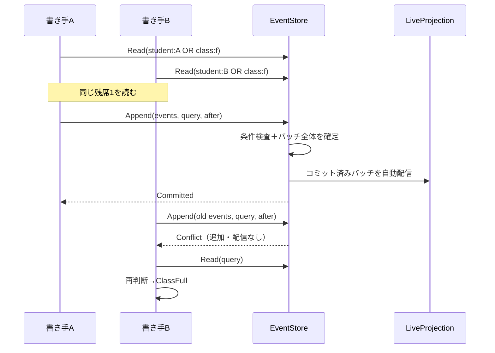

# Decider Level 3：7言語のインメモリES／DCB

[Level 2](../decider_level2/README.md)の履修ドメインを、タグで読む学籍・クラス・履修の判断モデルと、全イベントを受けるライブ一覧投影に分けました。C#、F#、Rust、TypeScript＋Zod、Java、Go、Swiftで、同じ機能とJSON契約を実装します。言語ごとの実コード、行数、空白以外の文字数を比較するためのサンプルです。

## 共通部品とドメインを分ける

| 言語 | 抽出できるライブラリ | 学校の型／判断 | 学校のタグ規則／コマンド接続 | 学校の投影 | 比較 |
|---|---|---|---|---|---|
| C# | [Dcb.cs](csharp/Dcb.cs) | [Models](csharp/Models.cs) / [Decider](csharp/Decider.cs) | [Routing](csharp/Routing.cs) / [Application](csharp/Application.cs) | [Projection](csharp/Projection.cs) | [README](csharp/README.md) |
| F# | [Dcb.fs](fsharp/Dcb.fs) | [Models](fsharp/Models.fs) / [Decider](fsharp/Decider.fs) | [Routing](fsharp/Routing.fs) / [Application](fsharp/Application.fs) | [Projection](fsharp/Projection.fs) | [README](fsharp/README.md) |
| Rust | [dcb.rs](rust/src/dcb.rs) | [models](rust/src/models.rs) / [decider](rust/src/decider.rs) | [routing](rust/src/routing.rs) / [application](rust/src/application.rs) | [projection](rust/src/projection.rs) | [README](rust/README.md) |
| TypeScript＋Zod | [dcb.ts](typescript/dcb.ts) | [models](typescript/models.ts) / [decider](typescript/decider.ts) | [routing](typescript/routing.ts) / [application](typescript/application.ts) | [projection](typescript/projection.ts) | [README](typescript/README.md) |
| Java | [Dcb.java](java/playground/dcb/Dcb.java) | [Models](java/Models.java) / [Decider](java/Decider.java) | [Routing](java/Routing.java) / [Application](java/Application.java) | [Projection](java/Projection.java) | [README](java/README.md) |
| Go | [dcb/store.go](go/dcb/store.go) | [models](go/domain/models.go) / [decider](go/domain/decider.go) | [routing](go/domain/routing.go) / [application](go/application.go) | [projection](go/domain/projection.go) | [README](go/README.md) |
| Swift | [dcb.swift](swift/dcb.swift) | [models](swift/models.swift) / [decider](swift/decider.swift) | [routing](swift/routing.swift) / [application](swift/application.swift) | [projection](swift/projection.swift) | [README](swift/README.md) |

共通部品はSchoolDomain、科目、学年、履修状態を参照しません。イベントをobject／Any／IEventPayloadへ変換せず、EventStore<E>とRecorded<E>にドメインの閉じたイベント型を渡します。コマンドCと拒否Rも型パラメーターです。ドメインのswitch／matchでは元のケースを列挙できます。

コマンド実行ループは具象メモリストアではなく、読み取りと条件付き追記を定義するinterface／trait／protocolに依存します。学校側はコマンドとHandlerをExecutorへ渡し、ストアと投影へはイベントのEventDescriptor、更新関数、コピー関数を渡します。

[独立ビルドテスト](tests/library_isolation.py)では学校のModels・Deciderを一切含めず、カウンター用のイベント・コマンドでライブラリをコンパイルして実行します。Javaは別パッケージ、Swiftは実際の別モジュールから利用します。Goはdcbパッケージだけを-race付きでテストします。

複数のドメインのイベントを同じ型付きログへ載せる場合は、ホストアプリがそれらをまとめる閉じたイベント集合とメタ情報の関数を定義します。その集合の更新はホストの責任で、ライブラリへ学校や請求などのケースを追加する必要はありません。任意のプラグインによる無制限な拡張と、固定ケースの網羅性を同時に保証する仕組みではありません。

## コマンドとHandlerをExecutorへ渡す

Sekibanの公開版（参照commit: `59b4976e3a582b1b831ac7427794227317039ad9`）では、該当する契約は[ICommandExecutor](https://github.com/J-Tech-Japan/Sekiban/blob/59b4976e3a582b1b831ac7427794227317039ad9/dcb/src/Sekiban.Dcb.WithoutResult/Commands/ICommandExecutor.cs)／ISekibanExecutorという名前で、コマンドとHandler関数を渡すExecuteAsyncを持ちます。[ICommandHandler](https://github.com/J-Tech-Japan/Sekiban/blob/59b4976e3a582b1b831ac7427794227317039ad9/dcb/src/Sekiban.Dcb.WithoutResult.Model/Commands/ICommandHandler.cs)と[インメモリのテストExecutor](https://github.com/J-Tech-Japan/Sekiban/blob/59b4976e3a582b1b831ac7427794227317039ad9/dcb/src/Sekiban.Dcb.WithoutResult.Testing/InMemoryDcbExecutorForTesting.cs)も参考にしています。

このサンプルも、学校固有のコマンドとHandlerを呼び出しごとにExecutorへ渡します。C#での入口は次の形です。他の言語はinterface、trait、関数record、protocolなど、その言語の型付き契約で表現します。

```csharp
IDcbExecutor<Event, Rejection> executor = new DcbExecutor<Event, Rejection>(store);
var result = executor.Execute("enroll-1", new Enroll("class-a", "student-1"), new SchoolHandler());
```

| 責務 | 担当 |
|---|---|
| Validate | Handlerが新規入力の属性・VO制約を検証。失敗したら読み取り・追記・配信を行わない |
| QueryFor | 学校のタグ規則から、判断に必要な読み取り／追記条件を選ぶ |
| Handle | 読んだイベントから判断モデルを作り、検証済み入力でDeciderを呼び、Emit／Rejectを返す |
| Decider | 学年・前提科目・座席・履修フェーズなど、状態に依存するルールで出力イベントを決める |
| Executor | 検証後の読み取り、Handlerの呼び出し、条件付き追記、競合時の読み直しと再判断 |
| Routing | タグ、読み取り条件、イベントの型名・タグのメタ情報。業務ハンドラーとは区別する |

Handlerは学校の9ケースをまとめる型付きHandlerです。個別HandlerがVOやDeciderによって自動的に不要になったという意味ではなく、現在の9コマンドの処理手順が共通なので共通Handlerを選んでいます。ライブラリの契約はコマンドとHandlerを組にして渡すため、個別Handlerにも対応できます。取得する外部データ・認可・副作用などの手順がコマンドごとに異なるなら分ける選択ができます。9個の具象クラスをリフレクションやDIで探索する構成ではありません。ライブラリは学校のCommand／Event／Rejectionを参照せず、別の数値コマンドとカウンターHandlerでも独立ビルド・実行します。

Prepare／Commitは競合を再現できるよう分離してあります。Prepareの返す値は元のHandlerと実行先を保持し、競合したら同じコマンド・同じHandlerから判断を作り直します。Rustはcommitで準備済み値を消費し、TypeScriptはprepare時に入力をコピー・凍結します。他の言語でもこのサンプルのCommandは不変のrecord／DU／値型です。PreparedCommandはメモリ内の値で、永続化・プロセス間転送のAPIではありません。

これはSekibanの全APIを複製した実装ではありません。非同期のCommandContext、タグ予約、サービスID、認証等は持たず、読み取り条件をHandlerが先に宣言する、小さな同期インメモリExecutorです。

## 入力検証・値オブジェクト・過去イベントの復元

StudentId、ClassId、SeatCapacity、AssessmentScore、SchoolDateを学校の意味を持つ型として定義し、新規入力用のfactoryと過去イベント用の復元経路を分けます。新規入力の検証に成功したValidatedCommandだけをDeciderへ渡します。wire上のCommand／Eventと一覧DTOは従来のプリミティブ表現を保ち、全Stateの全フィールドをVOに置き換えたわけではありません。

| 境界 | チェックするもの |
|---|---|
| JSON入力 | 必須項目、値の型、既知のケース、null等の表現契約 |
| 新しいCommand | 空白だけのID、定員1〜10、点数0〜100、実在するYYYY-MM-DD、enum等の現在の入力ルール |
| Decider | 進級条件、前提科目、満席、履修中か、出席したか、採点済みか等 |
| Eventの復元 | 型・位置・タグ等の保存形式の整合性を確認し、現在の入力ルールは再適用しない |

C#はpropertyのRequired・EnumDataTypeとVO制約の属性を[標準のOptions validation Source Generator](https://learn.microsoft.com/dotnet/core/extensions/options-validation-generator)でコンパイルします。検証のためのValidator.TryValidateObjectや動的なプロパティ探索は使いません。定員・点数・日付には、型付きの値制約を呼ぶ小さなValidationAttributeを使います。F#はprivate DU＋Result、Rustはnewtype＋TryFrom、TypeScriptはZodのrefinement＋brand、Javaは検証付きfactory、Goは非公開フィールド＋factory/error、Swiftは検証付きinitで対応します。

**新規入力で現在の制約を満たすことと、過去の事実として復元可能であることは別です。** Create／TryFrom等は新規入力用、FromEvent／fromEvent／restore等は保存済みの事実用です。後者を新規コマンドの抜け道にはせず、コマンドをExecutorへ渡すと必ず現在の検証が走ります。業務上の「今有効な値」であることはVOの存在だけでなくValidatedCommandという境界でも示します。

例えば、過去に許可されていた定員25、開始日`Spring 2020`、点数120を含むイベントは、その値を保って復元・一覧表示・再構築できます。一方、それらを新しいコマンドへ入れるとInvalidCapacity／InvalidDate／InvalidScoreで拒否します。[historical-values](fixtures/historical-values.json)が7言語共通のJSON回帰テストです。構造を読めないJSONや不整合なイベント位置まで無条件に受け入れる、という意味ではありません。

これは入力ポリシーと復元の分離です。合格点や単位数の計算そのものを将来変更したときの互換性は別に設計する必要があります。このサンプルはResultRecordedのscoreから合否を計算するため、そこまで変更するなら結果の事実をイベントへ含める、イベントを版管理する等の対応が必要です。

入力検証の失敗と業務判断の拒否は、どちらも型付きRejectionとして結果へ返します。入力検証で拒否したPreparedCommandはWasRead=false、Position=0です。この0は「0件の履歴を読んだ」のではなく、スナップショットを読んでいないことを示します。constructorがnullを拒否するJava等では、Executorへ届く前にエラーになる入力もあります。予期しない実装エラーまでRejectionへ握りつぶすことはしません。

## ドメインテスト

| 言語 | 入力検証・VO | Handler | ネイティブのドメインテスト |
|---|---|---|---|
| C# | [値型・検証](csharp/ValueObjects.cs) | [Handler](csharp/Handlers.cs) | [テスト](csharp/DomainTests.cs) |
| F# | [値型・検証](fsharp/ValueObjects.fs) | [Handler](fsharp/Handlers.fs) | [テスト](fsharp/DomainTests.fs) |
| Rust | [値型・検証](rust/src/value_objects.rs) | [Handler](rust/src/handlers.rs) | [テスト](rust/src/domain_tests.rs) |
| TypeScript＋Zod | [値型・検証](typescript/valueObjects.ts) | [Handler](typescript/handlers.ts) | [テスト](typescript/domain.test.ts) |
| Java | [値型・検証](java/ValueObjects.java) | [Handler](java/SchoolHandler.java) | [テスト](java/DomainTests.java) |
| Go | [値型・検証](go/domain/value_objects.go) | [Handler](go/domain/handlers.go) | [テスト](go/domain_test.go) |
| Swift | [値型・検証](swift/valueObjects.swift) | [Handler](swift/handlers.swift) | [テスト](swift/domainTests.swift) |

テストを3つの境界で使い分けます。

- **VO単体**：新規入力のfactoryの成功・拒否と、保存済み値の復元を直接確認します。
- **純粋なDecider**：ストアやExecutorを用意せず、状態と検証済み入力から、登録・拒否・授業開始の3例を確認します。
- **Executorを通すGWT**：独立したGivenのイベント履歴、Whenのコマンド、Thenの期待payload／Rejectionを各言語のコードで記述します。共通76ケースが9種類のコマンド、業務上の全拒否理由、境界値、履修条件、取り消しと再登録、過去イベントの復元をカバーします。

各GWTで、期待イベントの全payload、拒否時の無追記、入力検証時の読み取り0回、ライブ投影のcheckpointと全件再構築の一致も確認します。最後の1席に2コマンドを準備し、先行が成功した後、後続が再判断でClassFullになるテストを別に持ちます。型の偽装・null・enum等、言語ごとに起こり得る入口のテストもあります。

ドメインテストは全分岐の機械的なカバレッジ率を示すものではありません。InvalidHistoryのような保存形式の破損は[共通の不正入力fixtures](fixtures/invalid)で、実スレッドの競合・購読障害等は[ライブラリ独立テスト](tests/library_isolation.py)で別に確認します。

```bash
# 7言語のVO・Decider・Executorドメインテスト
python3 samples/decider_level3/tests/domain_tests.py
# C#属性Validatorも含めてNative AOTで実行
python3 samples/decider_level3/tests/domain_tests.py --language csharp --native-aot
# Goは標準のtesting、他の言語は--domain-testのインプロセスassertion runner
cd samples/decider_level3/go && go test -race -v .
```

## 学籍・クラス・履修の分離

1つの学校全体のStateをコマンド処理のたびに復元する方式をやめ、別々の更新関数で3つのレジストリを作ります。

| レジストリ | キー | 担当する情報 |
|---|---|---|
| StudentRegister | studentId | 学年・進級 |
| ClassRegister | classId | 科目、定員、名簿、募集／授業中／終了 |
| EnrollmentRegister | (classId, studentId) | 予約、出席、合否、取消、取得単位 |

インメモリの検索は線形走査で、タグ索引はまだ実装していません。判断側へ返すイベントだけをタグで絞ります。

ログ自体は1本です。集約ごとの独立した永続ストリームへ分割するのではなく、DCBのタグで必要な事実を選びます。Handlerはその読み取り結果だけから一時的なDecisionModelを作ります。ライブ一覧の全校データはコマンドの判断元にしません。

例えばbobのBへの登録では、student:bobの学年・過去の履修と、class:b1の状態をORクエリで読みます。別の生徒の学籍や、無関係なクラスの開講イベントまで読む必要はありません。タグで読む履修には科目が必要なので、StudentEnrolledへcourseを持たせています。

授業開始ではClassStartedと受講者ごとのStudyStartedを同じバッチに入れます。これによりクラスの授業開始と、各生徒の履修開始を別々のタグ履歴から復元できます。ClassCompletedには結果一覧を持たせ、クラスの終了状態の復元で別の学籍モデルを参照しません。

Level 2の業務ルールは維持しています。FoundationはYear2以上、AdvancedはYear3以上かつFoundation合格済み。定員は1〜10、採点には出席が必要で60点以上が合格、開始後の登録・取消は拒否します。履修フェーズはReserved／Studying／Passed／Failed／Withdrawnで、未確定値をnullで埋めません。

## タグ・型・コマンドのメタ情報

タグは表示用の文字列を連結せず、構造を持ちます。

```json
{"category":"enrollment","keys":["class-id","student-id"]}
```

タグ文字列はUnicodeスカラーの並びとして一致を判定します。学校ドメインのIDは、呼び出し元が同じ正規化形（NFC）で与える契約です。ドメイン側のSwiftのString辞書には正規等価性があるため、正規化形を混在させる入力は比較対象にしません。

一覧のキー順はUTF-8のバイト順に揃えています。カルチャ依存の比較やUTF-16順との違いは、大文字小文字と補助文字を含む回帰シナリオで確認します。

keysの順序は意味を持ちます。classId="c"とstudentId="a:b"、classId="c:a"とstudentId="b"は別のキーです。内部の履修キーにもtuple／struct／JSONタプル表現を使います。

| イベント | 自動付与するタグ |
|---|---|
| StudentRegistered／StudentPromoted | student(studentId) |
| ClassOpened／ClassStarted／ClassCompleted | class(classId) |
| StudentEnrolled／StudentDropped／StudyStarted／AttendanceRecorded／ResultRecorded | student、class、enrollment(classId, studentId) |

呼び出し側はタグや位置を手入力して追記しません。ストアに渡したドメインのdescribe関数がイベント型名とタグを返し、ストアが位置とcommandIdを付けます。読み込むログのメタ情報も同じ関数で検査します。enrollmentタグは個別履修の検索・診断に使えるメタ情報で、今回の業務コマンドの整合性条件はstudent／classタグを使います。

```text
Recorded<E>
  position  : ストアが採番する1からの連番
  commandId : コマンドから引き継ぐ識別子
  eventType : ドメインのdescribe関数が決める論理イベント型
  tags      : ドメインのdescribe関数が作る構造化タグ
  payload   : 元のドメインのイベント型E
```

commandIdは追跡用で、永続的な冪等キーではありません。同じIDのコマンドをもう一度送ることを、ストア全体で自動的に抑止する実装ではありません。

## 条件付き追記と再判断

[DCB公式仕様](https://dcb.events/specification/)のQueryとAppend Conditionの考え方を、小さな同期APIで実装しています。

- QueryItem内のtagsはAND、typesは指定された型のOR。typesが空なら型を限定しません。
- QueryItem同士はOR。itemsが空のQueryは全件です。
- Readは一致したイベントと、同じロックで取得したログ全体のafterを返します。afterは最後に一致したイベントの位置ではありません。
- Appendはafterより後に条件Queryへ一致するイベントがないかを検査し、なければバッチ全体を同じロックで追加します。
- 競合したバッチは追加も配信もしません。再読み取り・モデル更新・再判断を行い、再び拒否または新しいバッチを作ります。競合は最大3回で打ち切ります。

| コマンド | 読み取り・追記条件の範囲 |
|---|---|
| RegisterStudent／PromoteStudent | studentタグ |
| OpenClass／StartClass／CompleteClass | classタグ |
| Enroll | studentタグ OR classタグ |
| Drop／Attend／Assess | classタグ |



Prepare／Commit操作は、この競合をsleepなしで再現するテスト用スケジューラーです。業務コマンドそのものはRegisterStudent、Enrollなどの閉じたCommand型です。通常はExecuteが読み取りから再試行まで行います。準備時のRejectedは読み取り時点の判断として返し、書き込みを伴わない拒否に条件付き追記は行いません。

## 一覧はライブプロジェクションから返す

LiveProjection<E,S>も共通部品です。ドメインのreduceとcopyStateを受け取り、チェックポイントと状態を管理します。学校側は3つのレジストリを更新し、それらをSchoolListへ変換します。

- 起動時は全イベントを再生してから購読を登録します。再生と登録は追記と同じロックで行い、間にイベントが抜ける窓を作りません。
- 追記が成功したら、ストアがコミット済みバッチを自動配信します。アプリがその都度投影更新を呼ぶ方式ではありません。
- バッチを投影へ反映する場合も、更新後の状態と位置を一緒に公開します。
- 同じ位置の再配信は無視し、位置の欠落は拒否します。途中まで適用してチェックポイントだけ残すことはしません。
- ListAllは投影のスナップショットを返します。初期に取得した一覧が後続の更新で書き換わらないことも確認します。
- 全ログから別の投影を再構築し、ライブ投影と一致することを確認します。CLIのRebuildは照合用の再構築で、購読の自動復旧コマンドではありません。

購読関数が失敗を返した場合は切り離し、listenerFaultsへ記録します。C#・F#・Java・TypeScriptは例外、Goはpanic、Rustはunwindするpanicも通知失敗として分離します。追記済みの事実を追記失敗へ戻さず、他の購読者への配信を続けます。Swiftの購読関数は非throwingでfalseを返す契約です。Swiftのfatal errorやabort方式のpanicなど、プロセス自体の異常終了を回復するものではありません。

学校アプリは投影障害があれば古い一覧を黙って返さず、利用不可にします。コピー関数と更新関数は、有効なデータに対して純粋に動く必要があります。不変値はidentityコピーでよいですが、可変な配列やオブジェクトを使う場合は独立したコピーを渡す契約です。

## 大きなライブProjectionの更新方式

コマンド判断用のRegistersと、学校全体を保持するライブ一覧Projectionを分けました。後者は汎用のIndexedProjectionと、各言語のSchoolProjectionで実装します。

| 処理 | 更新用Projectionの扱い |
|---|---|
| 学籍・クラス・履修の検索 | ハッシュ索引から該当行を取得 |
| バッチ反映 | 変更したキーだけを一時領域へ積み、成功後に反映。全状態のcloneは行わない |
| 名簿への追加・取消 | 前後リンクと先頭・末尾・件数を更新。配列の末尾コピーや全件filterは行わない |
| 取消・再登録の繰り返し | 古いノードと所属索引を削除し、再登録を末尾へ追加 |
| 全件一覧 | 要求されたときにDTOを構築・ソートし、更新用の内部行を外へ返さない |
| 再配送 | checkpoint以前を無視。更新用索引へ触らない |

K/Vの行は不変値として扱い、Reducerは取得した行を直接変更せず、置換行を差分へ書きます。失敗や位置欠落では差分と新checkpointを破棄します。過去に返したSnapshotも変化しません。Rustは大きなCompletedの配列を更新時に複製しないよう、内部のクラスフェーズをArcで共有します。Swiftは辞書を保持する参照型を所有者とし、バッチへ辞書全体を渡してcopy-on-writeを起こす形を避けています。

内部ノードIDの0はリンクなしを表す索引用の値で、ドメインの生徒IDや未確定状態ではありません。ノードIDにはイベント位置を使いますが、その位置を配列添字にはせず、ハッシュのキーとして扱います。

これは、固定サイズのイベントを反映する際の仕事を状態全体の件数に依存させない改善です。ハッシュ表の拡張、GC、キャッシュ、キー長の影響までなくすものではありません。ClassCompletedに含まれる大量の結果など、イベントのpayload自身が大きい場合はその処理量が必要です。全件Snapshotの作成・ソートも件数に応じて増え、読み取り中は更新を待たせる場合があります。コマンド側のタグ検索は引き続き線形走査で、この計測にはストア検索・Command処理・JSONは含めません。

### サイズを増やすテスト

```bash
python3 samples/decider_level3/tests/projection_scaling.py --samples 3 --write
python3 samples/decider_level3/tests/projection_scaling.py --language csharp --native-aot --samples 1
```

1千・1万・10万生徒を同じ1クラスに登録します。現在の新規Commandの定員上限は10なので、このテストは過去の大きなクラスを表すイベントをProjectionへ直接供給します。Commandの検証を迂回して新しい業務コマンドを許可する変更ではありません。各サイズで同じ1,000回の出席更新と、新しい1,000人の登録＋履修追加を実施します。更新時間と全件Snapshotの時間を分け、索引のget/put/delete回数も記録します。出席はどのサイズでも1イベント3操作、登録＋履修追加は各実装で8〜9操作です。名簿と索引が大きくなっても、この操作数が増えないことを検査します。

同じテストで、バッチ途中のReducer失敗と位置欠落によるrollback、再配送、取得済みSnapshotの不変性、100回の取消・再登録後の順序と行数も確認します。各言語の独立ライブラリテストでも、学校型を使わない小さな索引でrollbackを検証します。

[ローカルの結果](observed/projection-scaling.md)と[各サンプル・環境・ソース指紋](observed/projection-scaling.json)を保存しています。短い更新の時間はJIT、GC、表の拡張等で揺れるため、一定時間の合否判定や言語順位には使いません。CIはサイズごとの正当性と一定の索引操作数を確認します。

## 言語ごとの選択

| 言語 | 今回使った特徴と制約 |
|---|---|
| C# | closed record、ジェネリックinterface、Source Generation。判断モデルはImmutableSortedDictionary、ライブ一覧は差分付きDictionaryと連結名簿。TagのEquals／HashCodeを明示 |
| F# | DU、ジェネリックinterface、関数注入。判断モデルは不変Map、ライブ一覧は差分付きDictionaryと連結名簿。.NET 11 JIT＋PGO |
| Rust | enum、trait、Mutex。判断モデルはBTreeMap、ライブ一覧は差分付きHashMapと連結名簿、クラスフェーズのArc共有 |
| TypeScript | Zodから型を導出、構造的なport。ライブ一覧はMapと変更行だけの差分、一覧DTOは要求時にコピー。単一イベントループ |
| Java | sealed record、公開generic interface、synchronized。判断モデルはコピーしたMap、ライブ一覧は差分付きHashMapと連結名簿 |
| Go | generic interface、structの複合キー、Mutex。ライブ一覧は変更行だけを置換するmapと連結名簿。type switchの網羅性検査はない |
| Swift | 関連値付きenum、protocol、Sendable、NSLock。ライブ一覧は参照型が辞書を所有して差分更新し、DTOへ値を取り出す |

TypeScriptの競合プローブは、同じ読み取りから準備した2つの追記をPromiseで実行する論理的競合です。Workersで同じストアを共有する並列処理ではありません。他の6言語では実際の2スレッド／goroutineを使います。Goではrace detectorも実行します。

## 実行と検証

```bash
python3 samples/decider_level3/run.py --language csharp --scenario last-seat
python3 samples/decider_level3/run.py --language fsharp --scenario start-redecide
python3 samples/decider_level3/run.py --language typescript --scenario live-snapshots
python3 samples/decider_level3/run.py --verify
python3 samples/decider_level3/run.py --language csharp --native-aot --verify
python3 samples/decider_level3/tests/library_isolation.py
python3 samples/decider_level3/tests/check_exhaustiveness.py
```

.NETはglobal.json固定の11.0.100です。F#はJIT＋PGO前提で、今回WASM・Native AOTは対象にしません。C#はJSONリフレクションを無効にしたNative AOTでも同じ機能を検証します。Nodeは24、Javaは21、Goは1.23以降、Rustはedition 2024対応stable、SwiftはFoundationを使います。

TypeScriptの型チェックには次を使います。

```bash
npm ci --prefix samples/file-based
npm ci --prefix samples/decider_level3/typescript
samples/file-based/node_modules/.bin/tsc -p samples/decider_level3/typescript/tsconfig.json
```

[固定期待値](fixtures/expected.json)を持つ18シナリオには、履修全体、残席競合、未作成時の競合、無関係なタグの更新、競合後に開始バッチを作り直すケース、区切り文字を含む複合キー、過去の一覧保持が含まれます。全シナリオでコミット済み履歴の再取り込みと投影再構築を確認し、全7言語の49組でメタ情報付きのログをそのまま交換してBへの履修を継続します。

readsはアプリから初回準備したQuery・after・件数の監査表示です。内部再試行の全読み取りログではありません。traceのconflictsと、再判断後に変わったイベントバッチも照合します。

別のカウンタードメインの独立ビルドでは、AND／OR／型フィルター、バッチ追記、競合時に追加しないこと、購読失敗の分離、遅い購読開始の追いつき、二重配信、欠落位置の拒否、再判断、ログのメタ情報検査、2つの書き手の勝者が1つになることを確認します。ケース追加の実験では、ライブラリを通してもドメインの網羅性検査が残ることを検証します。

## 範囲と参考にした設計

永続DB、ネットワーク、非同期I/O、outbox、分散購読、バックプレッシャー、コマンドIDの永続的冪等性、イベント・制度変更の版管理は対象外です。購読はストアのロック内で同期的に動きます。購読者はストアを再入呼び出しせず、I/Oせず、速い純粋な消費処理を行う契約です。これは配信順と単純さのための制約で、汎用の本番用イベントバスではありません。

再取り込みは型付きペイロード・位置・メタ情報を検査しますが、過去のすべての業務コマンドを再検証する処理ではありません。保存済みの事実として再生します。学年・科目条件は固定ポリシーで、公開モデルを不正に直接構築できないようにするsmart constructorも未実装です。

参考にしたのは[DCB仕様](https://dcb.events/specification/)と、[Sekibanのイベント候補](https://github.com/J-Tech-Japan/Sekiban/blob/main/dcb/src/Sekiban.Dcb.Core/Events/SerializableEventCandidate.cs)、[整合性タグ情報](https://github.com/J-Tech-Japan/Sekiban/blob/main/dcb/src/Sekiban.Dcb.Core/Commands/ConsistencyTagEntry.cs)、[メタ情報](https://github.com/J-Tech-Japan/Sekiban/blob/main/dcb/src/Sekiban.Dcb.Core.Model/Events/EventMetadata.cs)の分離です。Sekibanパッケージは使わず、タグ予約・Orleansのactor・SortableUniqueIdを移植していません。今回はタグごとの位置ではなく、全体位置とQueryの組合せで競合を判定します。

[Claude Opusの設計レビューと反映内容](reviews/opus-design-review.md)も残しています。

## コード量の比較

共通ライブラリとドメインテストを別枠にし、両方を除いた**アプリ側合計**を表示します。ファイル単位ではなく、混在するファイルはソース範囲単位で次の責務に分けます。

| 分類 | 含めるコード |
|---|---|
| Model・値オブジェクト | 学籍・履修・クラスの状態、VOとfactory／復元、イベント、拒否理由、判断入力のDecisionModel |
| Decider | 純粋な業務判断と補助関数、判断結果のAccepted／Rejected型 |
| コマンド・共通Handler・入力検証 | Command型、属性ValidatorとValidatedCommand、入力を検証しDeciderを呼ぶ学校のHandler |
| DCB接続・メタ情報 | Routingのタグ、Query条件、イベントの型名・タグ付与 |
| ドメイン投影 | ライブ一覧のSchoolProjection、判断モデル用の純粋Reducer、一覧DTOと生成処理。2つの更新方式を含む |
| ユースケース | Execute／Prepare／Commit／一覧／再構築／再配送のOperation型と実行制御、Trace型、チケット・実行履歴管理 |
| アプリ設定・JSON・CLI | ストア／投影／processorの生成と購読接続、入出力DTO、JSON変換、CLI、Application内のimport・namespace等の共通宣言 |
| 共通ライブラリ（別枠） | 学校に依存しないタグ・エンベロープ・ストアport・Handler／Executor契約・条件付き追記・再試行・ライブ投影基盤 |
| ドメインテスト（別枠） | 各言語の学校ドメインのGWT、VO、Decider、競合再判断、テスト用port・ヘルパー。アプリ側合計へ含めない |

汎用CommandProcessorの競合再判断ループは共通ライブラリ、学校の判断への接続はコマンド・ハンドラー、タグとQuery条件はDCB接続・メタ情報です。Application内の初期接続はアプリ設定、その後の実行制御はユースケースとして区別します。型に付随するJSON属性・Zodスキーマ・コンストラクター検証はその型の分類に含めます。独立した手書きJSON変換はアプリ設定・JSON・CLIに含めるため、JSON関連の総量を単独で表す列ではありません。

[分類定義](code_stats_classification.json)は各ソースの既定分類と上書き範囲（1始まり、両端を含む）を保持します。**各物理行を一度だけ分類し、その同じ行から行数と空白以外の文字数を加算**します。上書き範囲内の空行・括弧もその範囲の分類へ、それ以外の空行・括弧・import等はファイルの既定分類へ計上します。範囲指定のないファイル追加・範囲重複・削除・ソースSHA256の変化を検出して集計を停止するため、コード変更時には分類も再確認してください。末尾のソース範囲一覧で分類を確認できます。

- 空行・コメント・括弧だけの行を含む物理行数を数えます。
- 文字数はUnicodeの空白をすべて除いた文字数です。文字列・コメント中の空白も除き、バイト数とは区別します。
- ライブラリやJSON変換を含め、維持する各言語のソースを一度ずつ数えます。
- カウンターのライブラリテスト、検証Python、共有JSON fixtures、README、設定・依存ロック、コンパイラー生成物は除外します。学校ドメインの各言語のテストは別枠で含めます。Main内のテスト起動分岐はMainの一部として含めます。
- 自動整形や1行の長さで行数が変わるため、文字数と内訳を併せて比較します。このサンプルは速度・メモリのベンチマークではありません。

<!-- code-stats:start -->

### 行数（空行を含む）

| 言語 | Model・値オブジェクト | Decider | コマンド・共通Handler・入力検証 | DCB接続・メタ情報 | ドメイン投影 | ユースケース | アプリ設定・JSON・CLI | アプリ側合計（ライブラリ・テスト除外） | 共通ライブラリ（別枠） | ドメインテスト（別枠） |
|---|---:|---:|---:|---:|---:|---:|---:|---:|---:|---:|
| C# | 126 | 127 | 67 | 35 | 170 | 43 | 35 | 603 | 206 | 214 |
| F# | 122 | 99 | 40 | 31 | 152 | 54 | 45 | 543 | 156 | 189 |
| Rust | 132 | 113 | 42 | 31 | 107 | 40 | 25 | 490 | 164 | 158 |
| TypeScript＋Zod | 95 | 102 | 49 | 38 | 117 | 31 | 26 | 458 | 149 | 174 |
| Java | 244 | 126 | 101 | 31 | 129 | 66 | 22 | 719 | 162 | 165 |
| Go | 324 | 293 | 155 | 71 | 434 | 115 | 815 | 2,207 | 428 | 310 |
| Swift | 101 | 103 | 40 | 32 | 120 | 32 | 353 | 781 | 175 | 163 |

### 空白以外の文字数

| 言語 | Model・値オブジェクト | Decider | コマンド・共通Handler・入力検証 | DCB接続・メタ情報 | ドメイン投影 | ユースケース | アプリ設定・JSON・CLI | アプリ側合計（ライブラリ・テスト除外） | 共通ライブラリ（別枠） | ドメインテスト（別枠） |
|---|---:|---:|---:|---:|---:|---:|---:|---:|---:|---:|
| C# | 5,663 | 5,542 | 4,625 | 1,696 | 9,832 | 2,467 | 2,035 | 31,860 | 8,639 | 18,977 |
| F# | 4,881 | 5,068 | 2,137 | 1,965 | 8,491 | 2,639 | 1,625 | 26,806 | 7,296 | 17,455 |
| Rust | 5,143 | 5,707 | 2,216 | 2,308 | 9,919 | 2,884 | 1,677 | 29,854 | 10,468 | 27,133 |
| TypeScript＋Zod | 5,592 | 5,286 | 2,490 | 2,547 | 8,795 | 2,922 | 1,527 | 29,159 | 8,759 | 22,824 |
| Java | 8,304 | 6,106 | 3,673 | 2,241 | 10,716 | 3,614 | 1,536 | 36,190 | 9,467 | 19,311 |
| Go | 6,114 | 5,449 | 3,333 | 2,620 | 9,666 | 2,934 | 17,954 | 48,070 | 9,267 | 23,095 |
| Swift | 4,670 | 5,657 | 1,941 | 2,277 | 8,538 | 2,435 | 13,516 | 39,034 | 10,836 | 19,725 |

### 分類したソース範囲

同じファイルの中も責務で分けています。以下は行数・文字数に共通の分類です。

| 言語 | 分類 | ソース範囲 |
|---|---|---|
| C# | Model・値オブジェクト | [csharp/Models.cs:1–26](csharp/Models.cs#L1-L26) / [csharp/Models.cs:29–49](csharp/Models.cs#L29-L49) / [csharp/Models.cs:61–74](csharp/Models.cs#L61-L74) / [csharp/Models.cs:79–79](csharp/Models.cs#L79-L79) / [csharp/ValueObjects.cs:1–64](csharp/ValueObjects.cs#L1-L64) |
| C# | Decider | [csharp/Decider.cs:1–123](csharp/Decider.cs#L1-L123) / [csharp/Models.cs:75–78](csharp/Models.cs#L75-L78) |
| C# | コマンド・共通Handler・入力検証 | [csharp/Handlers.cs:1–16](csharp/Handlers.cs#L1-L16) / [csharp/Models.cs:50–60](csharp/Models.cs#L50-L60) / [csharp/ValueObjects.cs:65–104](csharp/ValueObjects.cs#L65-L104) |
| C# | DCB接続・メタ情報 | [csharp/Routing.cs:1–35](csharp/Routing.cs#L1-L35) |
| C# | ドメイン投影 | [csharp/Models.cs:27–27](csharp/Models.cs#L27-L27) / [csharp/Projection.cs:1–81](csharp/Projection.cs#L1-L81) / [csharp/SchoolProjection.cs:1–88](csharp/SchoolProjection.cs#L1-L88) |
| C# | ユースケース | [csharp/Application.cs:7–10](csharp/Application.cs#L7-L10) / [csharp/Application.cs:18–47](csharp/Application.cs#L18-L47) / [csharp/Models.cs:28–28](csharp/Models.cs#L28-L28) / [csharp/Models.cs:80–87](csharp/Models.cs#L80-L87) |
| C# | アプリ設定・JSON・CLI | [csharp/Application.cs:1–6](csharp/Application.cs#L1-L6) / [csharp/Application.cs:11–17](csharp/Application.cs#L11-L17) / [csharp/Program.cs:1–22](csharp/Program.cs#L1-L22) |
| C# | 共通ライブラリ | [csharp/Dcb.cs:1–206](csharp/Dcb.cs#L1-L206) |
| C# | ドメインテスト | [csharp/DomainTests.cs:1–164](csharp/DomainTests.cs#L1-L164) / [csharp/ProjectionTests.cs:1–50](csharp/ProjectionTests.cs#L1-L50) |
| F# | Model・値オブジェクト | [fsharp/Models.fs:1–72](fsharp/Models.fs#L1-L72) / [fsharp/Models.fs:74–74](fsharp/Models.fs#L74-L74) / [fsharp/Models.fs:76–76](fsharp/Models.fs#L76-L76) / [fsharp/Models.fs:88–101](fsharp/Models.fs#L88-L101) / [fsharp/Models.fs:106–106](fsharp/Models.fs#L106-L106) / [fsharp/ValueObjects.fs:1–33](fsharp/ValueObjects.fs#L1-L33) |
| F# | Decider | [fsharp/Decider.fs:1–95](fsharp/Decider.fs#L1-L95) / [fsharp/Models.fs:102–105](fsharp/Models.fs#L102-L105) |
| F# | コマンド・共通Handler・入力検証 | [fsharp/Handlers.fs:1–13](fsharp/Handlers.fs#L1-L13) / [fsharp/Models.fs:77–87](fsharp/Models.fs#L77-L87) / [fsharp/ValueObjects.fs:34–49](fsharp/ValueObjects.fs#L34-L49) |
| F# | DCB接続・メタ情報 | [fsharp/Routing.fs:1–31](fsharp/Routing.fs#L1-L31) |
| F# | ドメイン投影 | [fsharp/Models.fs:73–73](fsharp/Models.fs#L73-L73) / [fsharp/Projection.fs:1–58](fsharp/Projection.fs#L1-L58) / [fsharp/SchoolProjection.fs:1–93](fsharp/SchoolProjection.fs#L1-L93) |
| F# | ユースケース | [fsharp/Application.fs:6–7](fsharp/Application.fs#L6-L7) / [fsharp/Application.fs:13–55](fsharp/Application.fs#L13-L55) / [fsharp/Models.fs:75–75](fsharp/Models.fs#L75-L75) / [fsharp/Models.fs:107–114](fsharp/Models.fs#L107-L114) |
| F# | アプリ設定・JSON・CLI | [fsharp/Application.fs:1–5](fsharp/Application.fs#L1-L5) / [fsharp/Application.fs:8–12](fsharp/Application.fs#L8-L12) / [fsharp/Program.fs:1–35](fsharp/Program.fs#L1-L35) |
| F# | 共通ライブラリ | [fsharp/Dcb.fs:1–156](fsharp/Dcb.fs#L1-L156) |
| F# | ドメインテスト | [fsharp/DomainTests.fs:1–141](fsharp/DomainTests.fs#L1-L141) / [fsharp/ProjectionTests.fs:1–48](fsharp/ProjectionTests.fs#L1-L48) |
| Rust | Model・値オブジェクト | [rust/src/models.rs:1–58](rust/src/models.rs#L1-L58) / [rust/src/models.rs:67–67](rust/src/models.rs#L67-L67) / [rust/src/models.rs:78–104](rust/src/models.rs#L78-L104) / [rust/src/models.rs:118–133](rust/src/models.rs#L118-L133) / [rust/src/models.rs:140–140](rust/src/models.rs#L140-L140) / [rust/src/value_objects.rs:1–29](rust/src/value_objects.rs#L1-L29) |
| Rust | Decider | [rust/src/decider.rs:1–107](rust/src/decider.rs#L1-L107) / [rust/src/models.rs:134–139](rust/src/models.rs#L134-L139) |
| Rust | コマンド・共通Handler・入力検証 | [rust/src/handlers.rs:1–14](rust/src/handlers.rs#L1-L14) / [rust/src/models.rs:105–117](rust/src/models.rs#L105-L117) / [rust/src/value_objects.rs:30–44](rust/src/value_objects.rs#L30-L44) |
| Rust | DCB接続・メタ情報 | [rust/src/routing.rs:1–31](rust/src/routing.rs#L1-L31) |
| Rust | ドメイン投影 | [rust/src/models.rs:59–66](rust/src/models.rs#L59-L66) / [rust/src/projection.rs:1–38](rust/src/projection.rs#L1-L38) / [rust/src/school_projection.rs:1–61](rust/src/school_projection.rs#L1-L61) |
| Rust | ユースケース | [rust/src/application.rs:10–16](rust/src/application.rs#L10-L16) / [rust/src/application.rs:21–33](rust/src/application.rs#L21-L33) / [rust/src/models.rs:68–77](rust/src/models.rs#L68-L77) / [rust/src/models.rs:141–150](rust/src/models.rs#L141-L150) |
| Rust | アプリ設定・JSON・CLI | [rust/src/application.rs:1–9](rust/src/application.rs#L1-L9) / [rust/src/application.rs:17–20](rust/src/application.rs#L17-L20) / [rust/src/main.rs:1–12](rust/src/main.rs#L1-L12) |
| Rust | 共通ライブラリ | [rust/src/dcb.rs:1–164](rust/src/dcb.rs#L1-L164) |
| Rust | ドメインテスト | [rust/src/domain_tests.rs:1–131](rust/src/domain_tests.rs#L1-L131) / [rust/src/projection_tests.rs:1–27](rust/src/projection_tests.rs#L1-L27) |
| TypeScript＋Zod | Model・値オブジェクト | [typescript/models.ts:1–51](typescript/models.ts#L1-L51) / [typescript/models.ts:54–54](typescript/models.ts#L54-L54) / [typescript/models.ts:57–57](typescript/models.ts#L57-L57) / [typescript/models.ts:70–84](typescript/models.ts#L70-L84) / [typescript/models.ts:90–90](typescript/models.ts#L90-L90) / [typescript/models.ts:100–100](typescript/models.ts#L100-L100) / [typescript/valueObjects.ts:1–19](typescript/valueObjects.ts#L1-L19) / [typescript/valueObjects.ts:41–46](typescript/valueObjects.ts#L41-L46) |
| TypeScript＋Zod | Decider | [typescript/decider.ts:1–97](typescript/decider.ts#L1-L97) / [typescript/models.ts:85–89](typescript/models.ts#L85-L89) |
| TypeScript＋Zod | コマンド・共通Handler・入力検証 | [typescript/handlers.ts:1–16](typescript/handlers.ts#L1-L16) / [typescript/models.ts:58–69](typescript/models.ts#L58-L69) / [typescript/valueObjects.ts:20–40](typescript/valueObjects.ts#L20-L40) |
| TypeScript＋Zod | DCB接続・メタ情報 | [typescript/routing.ts:1–38](typescript/routing.ts#L1-L38) |
| TypeScript＋Zod | ドメイン投影 | [typescript/models.ts:52–53](typescript/models.ts#L52-L53) / [typescript/projection.ts:1–51](typescript/projection.ts#L1-L51) / [typescript/schoolProjection.ts:1–64](typescript/schoolProjection.ts#L1-L64) |
| TypeScript＋Zod | ユースケース | [typescript/application.ts:8–8](typescript/application.ts#L8-L8) / [typescript/application.ts:13–31](typescript/application.ts#L13-L31) / [typescript/models.ts:55–56](typescript/models.ts#L55-L56) / [typescript/models.ts:91–99](typescript/models.ts#L91-L99) |
| TypeScript＋Zod | アプリ設定・JSON・CLI | [typescript/application.ts:1–7](typescript/application.ts#L1-L7) / [typescript/application.ts:9–12](typescript/application.ts#L9-L12) / [typescript/main.ts:1–10](typescript/main.ts#L1-L10) / [typescript/models.ts:101–101](typescript/models.ts#L101-L101) / [typescript/wire.ts:1–4](typescript/wire.ts#L1-L4) |
| TypeScript＋Zod | 共通ライブラリ | [typescript/dcb.ts:1–149](typescript/dcb.ts#L1-L149) |
| TypeScript＋Zod | ドメインテスト | [typescript/domain.test.ts:1–141](typescript/domain.test.ts#L1-L141) / [typescript/projection.test.ts:1–33](typescript/projection.test.ts#L1-L33) |
| Java | Model・値オブジェクト | [java/Models.java:1–45](java/Models.java#L1-L45) / [java/Models.java:62–143](java/Models.java#L62-L143) / [java/Models.java:211–286](java/Models.java#L211-L286) / [java/ValueObjects.java:1–41](java/ValueObjects.java#L1-L41) |
| Java | Decider | [java/Decider.java:1–109](java/Decider.java#L1-L109) / [java/Models.java:287–303](java/Models.java#L287-L303) |
| Java | コマンド・共通Handler・入力検証 | [java/Models.java:144–210](java/Models.java#L144-L210) / [java/SchoolHandler.java:1–11](java/SchoolHandler.java#L1-L11) / [java/ValueObjects.java:42–64](java/ValueObjects.java#L42-L64) |
| Java | DCB接続・メタ情報 | [java/Routing.java:1–31](java/Routing.java#L1-L31) |
| Java | ドメイン投影 | [java/Models.java:46–53](java/Models.java#L46-L53) / [java/Projection.java:1–53](java/Projection.java#L1-L53) / [java/SchoolProjection.java:1–68](java/SchoolProjection.java#L1-L68) |
| Java | ユースケース | [java/Application.java:6–6](java/Application.java#L6-L6) / [java/Application.java:10–26](java/Application.java#L10-L26) / [java/Models.java:54–61](java/Models.java#L54-L61) / [java/Models.java:304–343](java/Models.java#L304-L343) |
| Java | アプリ設定・JSON・CLI | [java/Application.java:1–5](java/Application.java#L1-L5) / [java/Application.java:7–9](java/Application.java#L7-L9) / [java/Main.java:1–14](java/Main.java#L1-L14) |
| Java | 共通ライブラリ | [java/playground/dcb/Dcb.java:1–162](java/playground/dcb/Dcb.java#L1-L162) |
| Java | ドメインテスト | [java/DomainTests.java:1–138](java/DomainTests.java#L1-L138) / [java/ProjectionTests.java:1–27](java/ProjectionTests.java#L1-L27) |
| Go | Model・値オブジェクト | [go/domain/models.go:1–81](go/domain/models.go#L1-L81) / [go/domain/models.go:96–169](go/domain/models.go#L96-L169) / [go/domain/models.go:235–308](go/domain/models.go#L235-L308) / [go/domain/value_objects.go:1–88](go/domain/value_objects.go#L1-L88) / [go/domain/value_objects.go:154–160](go/domain/value_objects.go#L154-L160) |
| Go | Decider | [go/domain/decider.go:1–280](go/domain/decider.go#L1-L280) / [go/domain/models.go:309–321](go/domain/models.go#L309-L321) |
| Go | コマンド・共通Handler・入力検証 | [go/domain/handlers.go:1–25](go/domain/handlers.go#L1-L25) / [go/domain/models.go:170–234](go/domain/models.go#L170-L234) / [go/domain/value_objects.go:89–153](go/domain/value_objects.go#L89-L153) |
| Go | DCB接続・メタ情報 | [go/domain/routing.go:1–71](go/domain/routing.go#L1-L71) |
| Go | ドメイン投影 | [go/domain/models.go:82–87](go/domain/models.go#L82-L87) / [go/domain/projection.go:1–190](go/domain/projection.go#L1-L190) / [go/domain/school_projection.go:1–238](go/domain/school_projection.go#L1-L238) |
| Go | ユースケース | [go/application.go:25–25](go/application.go#L25-L25) / [go/application.go:32–101](go/application.go#L32-L101) / [go/domain/models.go:88–95](go/domain/models.go#L88-L95) / [go/domain/models.go:322–357](go/domain/models.go#L322-L357) |
| Go | アプリ設定・JSON・CLI | [go/application.go:1–24](go/application.go#L1-L24) / [go/application.go:26–31](go/application.go#L26-L31) / [go/domain/json.go:1–694](go/domain/json.go#L1-L694) / [go/main.go:1–39](go/main.go#L1-L39) / [go/wire.go:1–52](go/wire.go#L1-L52) |
| Go | 共通ライブラリ | [go/dcb/store.go:1–428](go/dcb/store.go#L1-L428) |
| Go | ドメインテスト | [go/domain_test.go:1–211](go/domain_test.go#L1-L211) / [go/projection_tests.go:1–99](go/projection_tests.go#L1-L99) |
| Swift | Model・値オブジェクト | [swift/models.swift:1–33](swift/models.swift#L1-L33) / [swift/models.swift:48–64](swift/models.swift#L48-L64) / [swift/models.swift:76–87](swift/models.swift#L76-L87) / [swift/valueObjects.swift:1–39](swift/valueObjects.swift#L1-L39) |
| Swift | Decider | [swift/decider.swift:1–99](swift/decider.swift#L1-L99) / [swift/models.swift:88–91](swift/models.swift#L88-L91) |
| Swift | コマンド・共通Handler・入力検証 | [swift/handlers.swift:1–11](swift/handlers.swift#L1-L11) / [swift/models.swift:65–75](swift/models.swift#L65-L75) / [swift/valueObjects.swift:40–57](swift/valueObjects.swift#L40-L57) |
| Swift | DCB接続・メタ情報 | [swift/routing.swift:1–32](swift/routing.swift#L1-L32) |
| Swift | ドメイン投影 | [swift/models.swift:34–39](swift/models.swift#L34-L39) / [swift/projection.swift:1–49](swift/projection.swift#L1-L49) / [swift/schoolProjection.swift:1–65](swift/schoolProjection.swift#L1-L65) |
| Swift | ユースケース | [swift/application.swift:4–4](swift/application.swift#L4-L4) / [swift/application.swift:8–22](swift/application.swift#L8-L22) / [swift/models.swift:40–47](swift/models.swift#L40-L47) / [swift/models.swift:92–99](swift/models.swift#L92-L99) |
| Swift | アプリ設定・JSON・CLI | [swift/application.swift:1–3](swift/application.swift#L1-L3) / [swift/application.swift:5–7](swift/application.swift#L5-L7) / [swift/main.swift:1–9](swift/main.swift#L1-L9) / [swift/wire.swift:1–338](swift/wire.swift#L1-L338) |
| Swift | 共通ライブラリ | [swift/dcb.swift:1–175](swift/dcb.swift#L1-L175) |
| Swift | ドメインテスト | [swift/domainTests.swift:1–135](swift/domainTests.swift#L1-L135) / [swift/projectionTests.swift:1–28](swift/projectionTests.swift#L1-L28) |

<!-- code-stats:end -->

```bash
python3 samples/decider_level3/code_stats.py --write
python3 samples/decider_level3/code_stats.py --check
python3 samples/decider_level3/code_stats.py --json
python3 samples/decider_level3/check_readmes.py
```
